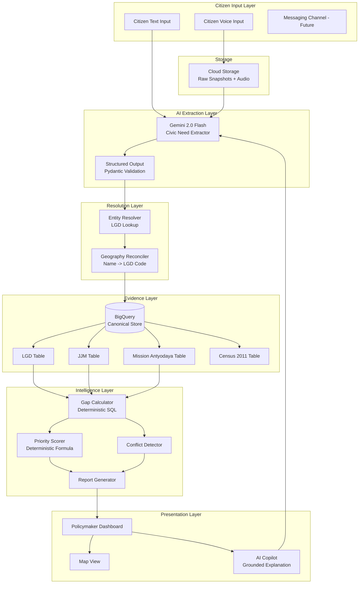
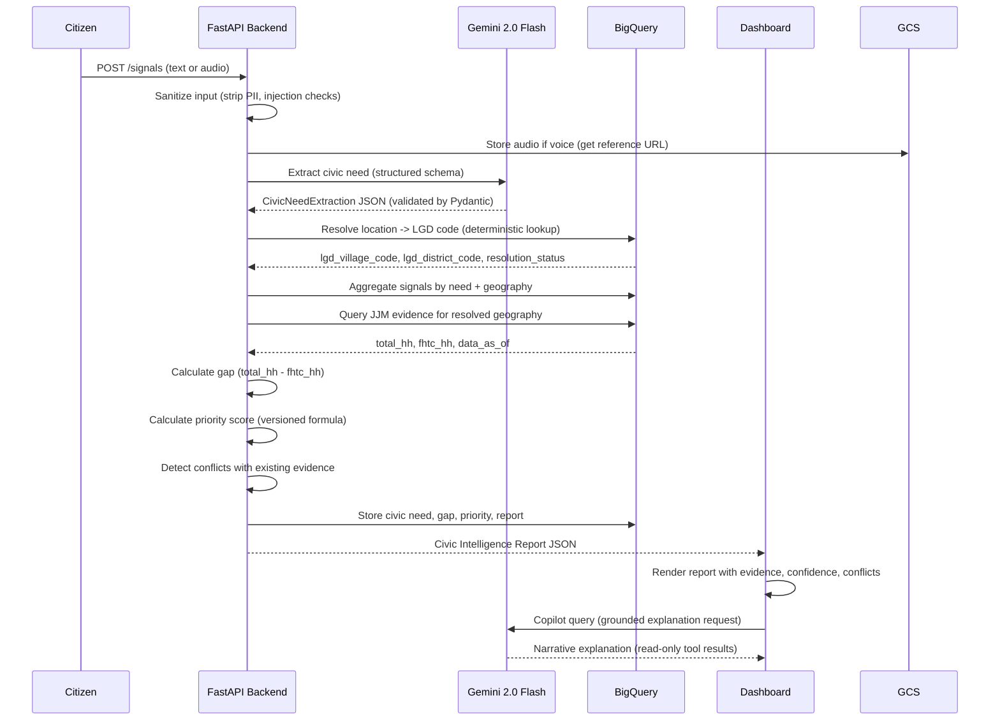
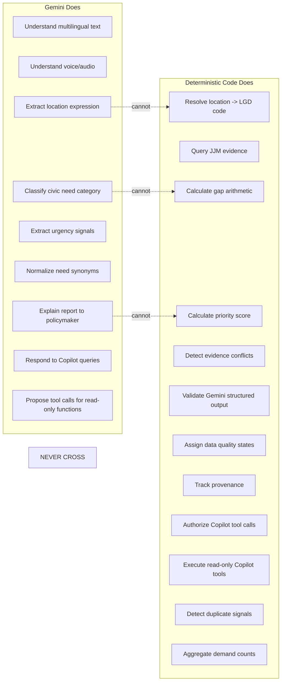
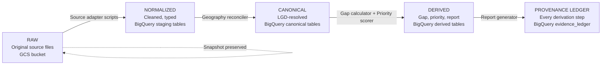
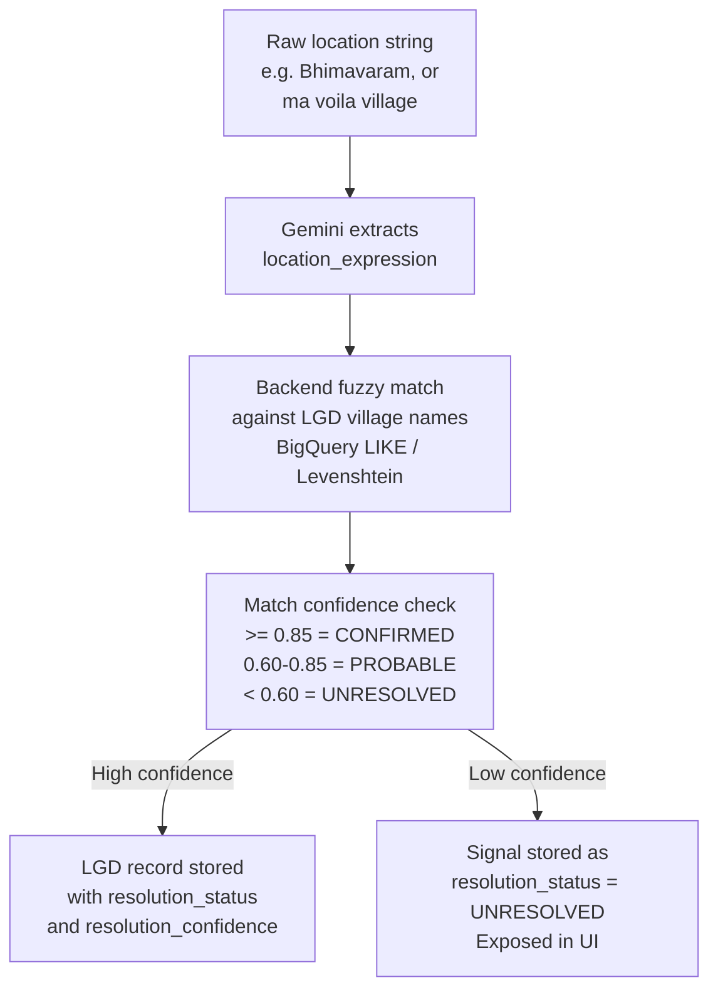
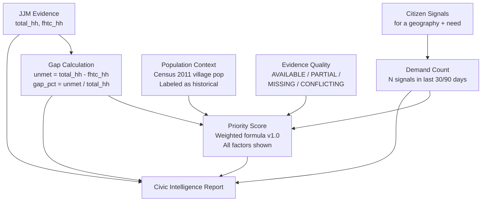
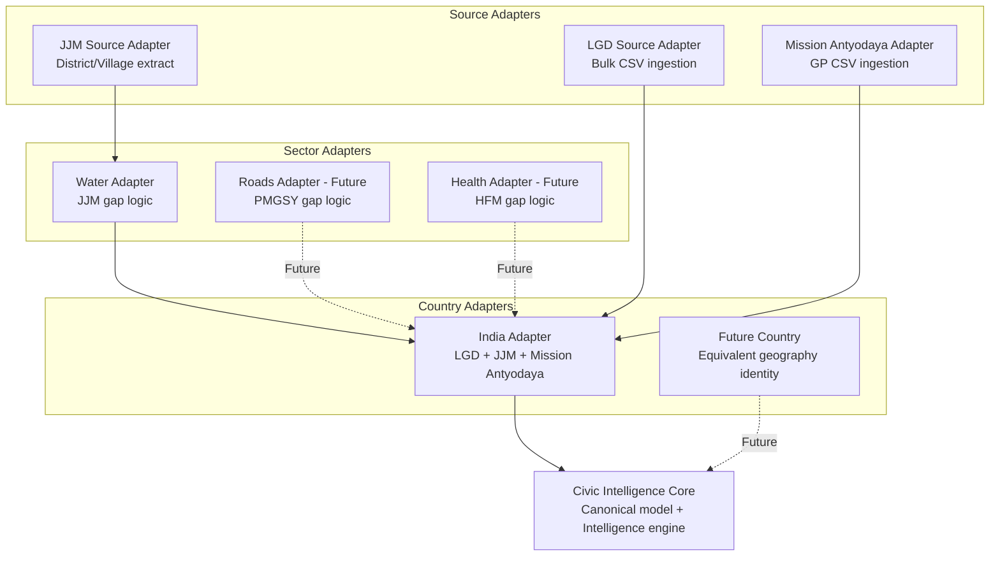

# System Architecture

> Civic Demand Intelligence & Planning Platform -- Architecture V1
> Last updated: 2026-09-24

---

## 1. System Boundary

The platform is an **intelligence layer** between citizen demand and development planning.

**Inside the system boundary:**
- Citizen signal ingestion (text, voice, multilingual)
- AI-powered civic need extraction and normalization
- Administrative geography resolution (LGD)
- Public evidence querying and storage
- Deterministic gap and priority calculation
- Civic Intelligence Report generation
- Policymaker dashboard and AI Copilot

**Outside the system boundary:**
- Government portal administration
- Actual delivery of development projects
- Policy decision-making (humans remain responsible)
- Live government API management
- Payment or procurement systems

---

## 2. System Overview Diagram



---

## 3. End-to-End Signal Flow



---

## 4. AI vs Deterministic Boundary

This is the most critical architectural boundary in the system.



**Key rule:** Gemini produces structured JSON that the backend validates. The backend then runs all calculations. Gemini is shown the results and asked to explain them -- it never generates them.

---

## 5. Data Lifecycle



---

## 6. Geography Reconciliation



**The 2022 AP reorganization is handled** by a `lgd_historical_mapping` table that bridges pre-2022 district names to post-2022 LGD codes. This is not a GIS problem -- it is a name/code reconciliation table.

---

## 7. Gap to Priority Pipeline



**Priority Formula v1.0:**
```
priority_score = (
  w_gap     * gap_pct +
  w_demand  * normalized_demand_count +
  w_pop     * normalized_population_impact +
  w_quality * evidence_quality_multiplier
)

Where:
  w_gap     = 0.40  (biggest weight -- actual infrastructure deficit)
  w_demand  = 0.30  (citizen demand signal strength)
  w_pop     = 0.20  (population affected)
  w_quality = 0.10  (evidence quality bonus/penalty)

All weights sum to 1.0 and are configurable via admin interface.
Formula version tracked as priority_schema_version = "1.0.0"
```

**What this formula CANNOT include in MVP (data not yet available):**
- Urgency from government declarations (future)
- Existing intervention coverage (future -- e-GramSwaraj)
- Accessibility penalty (future)

---

## 8. Civic Intelligence Report Structure

The report is the central user-facing output. It contains:

| Section | Content | Source |
|---------|---------|--------|
| Need | Civic need category + description | Gemini extraction + normalization |
| Location | District + Block + Village + LGD codes | LGD resolution |
| Citizen Demand | Signal count + trend | Aggregated signals |
| Population Context | Village/block population | Census 2011 (labeled historical) |
| Infrastructure State | Households with tap water | JJM evidence |
| Gap | Unmet households + gap percentage | Deterministic calculation |
| Priority | Score + factor breakdown | Deterministic formula |
| Evidence Quality | AVAILABLE / PARTIAL / CONFLICTING | Data quality assessment |
| Conflicts | Any conflicting sources | Conflict detector |
| Recommendation | Narrative guidance | Gemini (grounded on above) |
| Provenance | Full evidence trail | Evidence ledger |

---

## 9. Country / Sector / Source Adapter Pattern

The platform is designed for extensibility without implementing extensions now.



**Adapter contracts:** Each adapter must implement:
- `ingest_source(snapshot_ref) -> NormalizedDataset`
- `resolve_geography(source_id) -> CanonicalGeography`
- `calculate_gap(canonical_geography) -> GapAssessment`

These are **interface definitions only** -- not implemented until the adapter is needed.

---

## 10. Deployment Architecture (Summary)

See [deployment-architecture.md](deployment-architecture.md) for full detail.

```
Cloud Run (backend)  <-->  BigQuery (data)
       |                       ^
       v                       |
Cloud Storage (raw)    Cloud Run (frontend)
       |                       |
Secret Manager         Firebase Auth
       |                       |
Gemini API             Google Maps API
```

---

## 11. Architectural Decisions Summary

All significant decisions are documented in [docs/adr/](../adr/).

| Decision | Choice | Key Reason |
|----------|--------|-----------|
| Geography identity | LGD numeric codes | Immutable, national, tabular |
| Deep sector | Water / JJM | Arithmetic gap; highest data fidelity |
| Analytical database | BigQuery | Serverless SQL analytics; no ops overhead |
| Spatial strategy | Tabular joins only (MVP) | No GIS risk on 6-day timeline |
| AI role | Extract + explain only | Prevents hallucination of official stats |
| Deployment | Cloud Run (monorepo, 2 services) | Simplest credible serverless path |
| Auth | Firebase Authentication | Managed; Google provider |
| Maps | Google Maps JS API (pins) | No advanced GIS needed for MVP |
| Data ingestion | Static CSV snapshots to BQ | Eliminates live API dependency |
| Synthetic data | Isolated with `is_synthetic` flag | Evidence integrity |

---

*Architecture V1 -- 2026-09-24*
